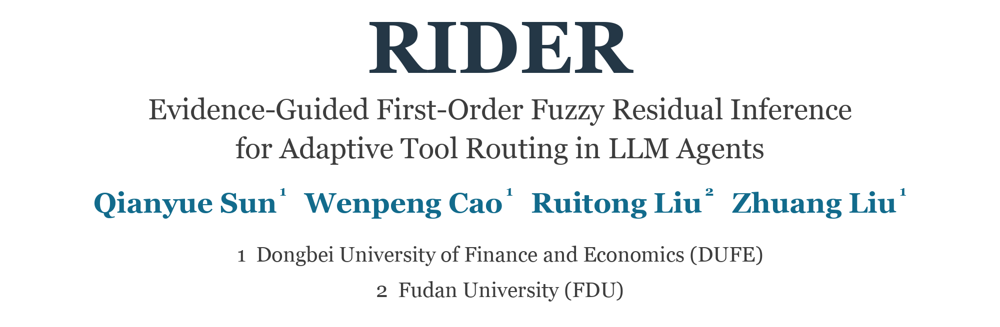
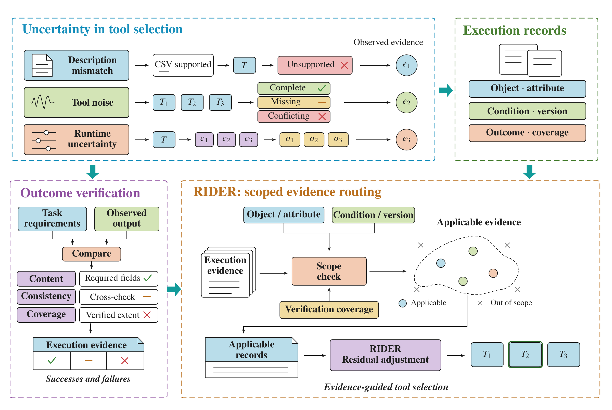
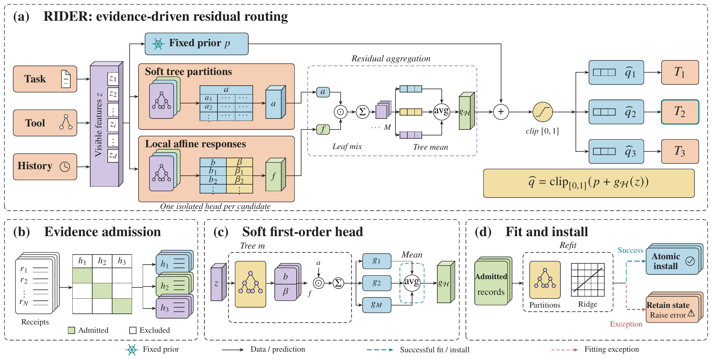
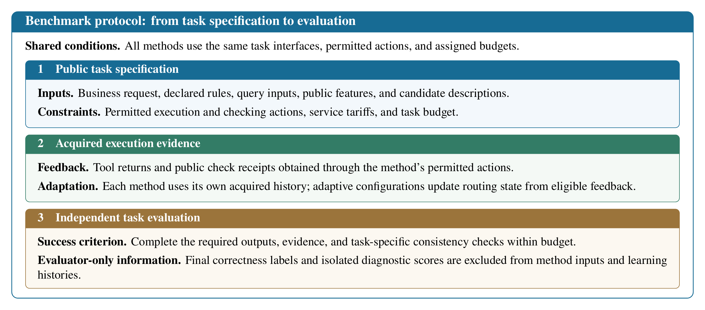
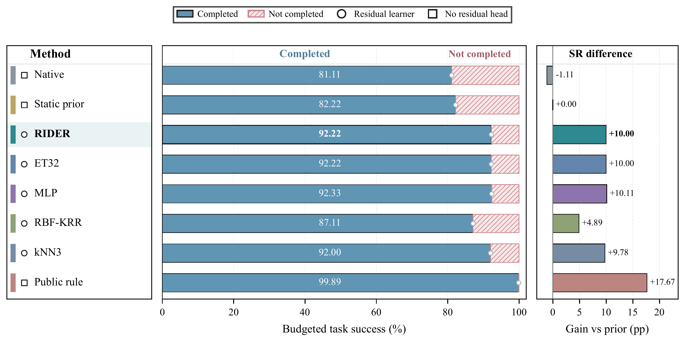
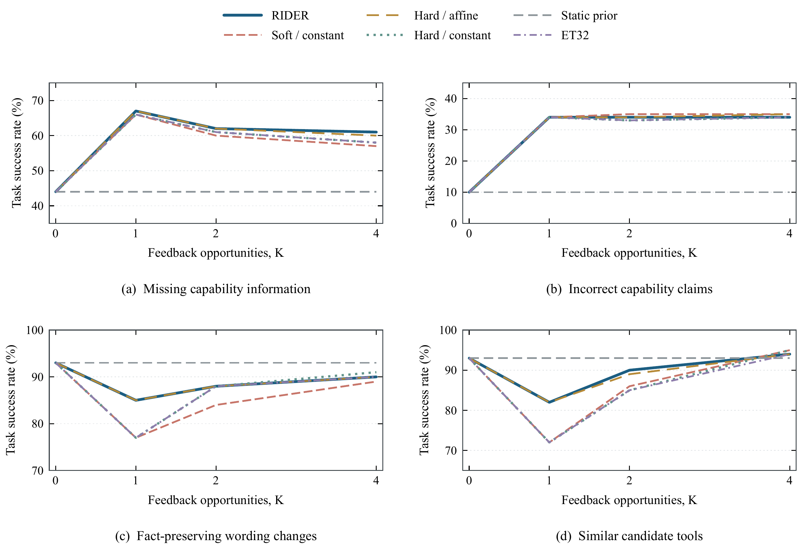
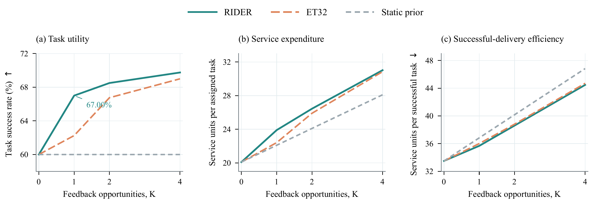

<a id="readme"></a>

<div align="center">

<picture>
  <source media="(prefers-color-scheme: dark)" srcset="assets/readme/header_dark.png">
  
</picture>

<p>
<a href="#overview">Overview</a> ·
<a href="#benchmark">Benchmark</a> ·
<a href="#release-status">Release Status</a> ·
<a href="#selected-figures">Selected Figures</a> ·
<a href="#citation">Citation</a>
</p>

<p>
<a href="#citation"></a>
<a href="benchmark/readme.txt"></a>
<a href="pyproject.toml"></a>
<a href="src/readme.txt"></a>
<a href="#license"></a>
</p>

<p><b>Research preview · Full code and benchmark will be released upon acceptance.</b></p>

<table align="center">
  <tr>
    <td align="center" width="150"><h3>1,080</h3><sub>study outer units</sub></td>
    <td align="center" width="150"><h3>900 / 90 / 90</h3><sub>formal / development / calibration</sub></td>
    <td align="center" width="150"><h3>3 × 3</h3><sub>uncertainty dimensions × subscenarios</sub></td>
    <td align="center" width="150"><h3>Preview</h3><sub>selected non-core examples</sub></td>
  </tr>
</table>

<br>

<p><em>Routing follows verified, scope-bound evidence.</em></p>
</div>

> **TL;DR.** RIDER uses verified, scope-bound feedback to learn a residual correction to a routing prior, then selects tools with the corrected score. This repository presents the research overview, manuscript figures, and selected non-core examples.

## News

- **2026-11** — Public preview with illustrative protocol formats and a runtime accounting utility. Full code and benchmark will be released upon acceptance.

## Contents

- [Overview](#overview)
- [Model Settings](#model-settings)
- [Benchmark](#benchmark)
- [Selected Figures](#selected-figures)
- [Release Status](#release-status)
- [Repository Structure](#repository-structure)
- [License](#license)
- [Citation](#citation)

## Overview

RIDER binds feedback to the task, candidate and execution scope in which it was verified. The residual head learns how observed feedback differs from the routing prior and applies that local correction to subsequent decisions.

1. **Bind evidence to scope.** Retain the context, candidate identity and verification receipt.
2. **Form residual targets.** For prior score $p$ and observed feedback $y$, use $r = y - p$.
3. **Infer a correction.** Estimate $g$ from eligible evidence in the relevant representation.
4. **Route with the corrected score.** Compute `q = min(1, max(0, p + g))`, i.e. clip the corrected score to `[0, 1]`.

<div align="center">
<a href="assets/readme/rider_architecture.pdf"></a>
</div>

The residual head combines **32 ExtraTrees partitions**, **local affine responses**, **soft leaf mixing within each tree**, and **uniform averaging across trees**.

## Model Settings

The manuscript's experimental setup specifies the following local assets and API request configurations.

| Backbone | Deployment and asset / request ID | Reasoning and sampling | Max output | Request timeout |
|:--|:--|:--|--:|--:|
| **Qwen** | Local; model card `Qwen3.8-27B`<br>Declared architecture `Qwen3_5ForConditionalGeneration` | Thinking disabled; temperature `0` | 2,048 tokens | 180 s |
| **Gemma** | Local BF16; `gemma-4-31b-it` | Thinking disabled; temperature `0`; top-p `1` | 8,192 tokens | 600 s |
| **DeepSeek 4.1-Flash** | OpenAI-compatible gateway; request ID `deepseek-flash` | Thinking enabled; high reasoning effort | 8,192 tokens | 600 s |
| **GLM 5.3-Flash** | OpenAI-compatible gateway; request ID `glm-5.3-flash` | Thinking enabled; maximum reasoning effort; temperature `1`; top-p `0.95` | 8,192 tokens | 600 s |

## Benchmark

The study's controlled benchmark comprises **1,080 outer task units**: 900 formal, 90 development and 90 calibration. These counts describe the study dataset; this preview contains selected illustrative formats.

| Dimension | What varies | Subscenarios |
|:--|:--|:--:|
| **D — Description discrepancy** | Available descriptions versus the underlying task or capability | 3 |
| **N — Candidate-output noise** | Variability or corruption in candidate outputs | 3 |
| **E — Execution environment** | Conditions under which candidate behavior is executed and observed | 3 |

### Benchmark Protocol

<div align="center">
<a href="assets/readme/benchmark_protocol.pdf"></a>
<p><em>Public task specifications, acquired execution evidence, and independent task evaluation.</em></p>
</div>

The panel is a layout extraction of the manuscript's benchmark protocol box. The software-routing study also examines date, CSV and SQL tasks based on public specifications.

See the [benchmark release notice](benchmark/readme.txt) and [illustrative protocol formats](benchmark/examples/software_protocol.json).

## Selected Figures

Selected summary plots from the manuscript.

### Overall task delivery

<div align="center">
<a href="assets/readme/readme_main_performance.pdf"></a>
</div>

Overall budgeted task success and gains over the static prior across eight methods. RIDER and ET32 reach 92.22%; Public Rule achieves the highest success rate at 99.89%.

### Learning from feedback

<div align="center">
<a href="assets/readme/ablation_learning.pdf"></a>
</div>

Fixed-feedback learning curves compare RIDER, three structural ablations, ET32 and the static prior across four scenarios, showing how task success changes with feedback opportunities.

### Utility and service expenditure

<div align="center">
<a href="assets/readme/budget_efficiency.pdf"></a>
</div>

The panels track task success, synthetic service units per assigned task, and units per successful task as feedback increases, making the delivery–expenditure trade-off explicit.

## Release Status

**待录用后发布全部完整代码。** Full code and benchmark will be released upon acceptance.

The current preview provides:

- [Protocol format examples](benchmark/examples/software_protocol.json): illustrative tool-return and verification-feedback objects.
- [Runtime accounting utility](src/rider/accounting.py): non-core timing intervals and policy-call usage bookkeeping, using the Python standard library.
- Manuscript figures and research overview.

The protocol objects are illustrative formats, not benchmark task instances. The full routing implementation, dataset, generators, evaluators and experiment pipelines are reserved for the full release. The preview package contains only the selected accounting utility; experiment reproduction instructions will accompany the full release.

## Repository Structure

```text
.
├── assets/readme/                       manuscript figures and light/dark title images
├── benchmark/
│   ├── readme.txt                       full benchmark release notice
│   └── examples/software_protocol.json  illustrative return and feedback formats
├── src/
│   ├── readme.txt                       full source release notice
│   └── rider/
│       ├── __init__.py                  preview package metadata
│       └── accounting.py                non-core runtime accounting utility
├── catalog.json                         public preview inventory
└── pyproject.toml                       preview package metadata
```

## License

**License pending.** Terms will be added after review.

## Citation

Provisional manuscript citation:

```bibtex
@misc{sun2026rider,
  title={RIDER: Evidence-Guided First-Order Fuzzy Residual Inference for Adaptive Tool Routing in LLM Agents},
  author={Sun, Qianyue and Cao, Wenpeng and Liu, Ruitong and Liu, Zhuang},
  year={2026},
  note={Manuscript}
}
```

## Contact

Please use [repository issues](https://github.com/RRRosmontis/RIDER/issues) for questions about the research and release.

<br>
<div align="center">
<sub>RIDER · Evidence-based routing through residual inference</sub><br>
<a href="#readme">Back to top ↑</a>
</div>
